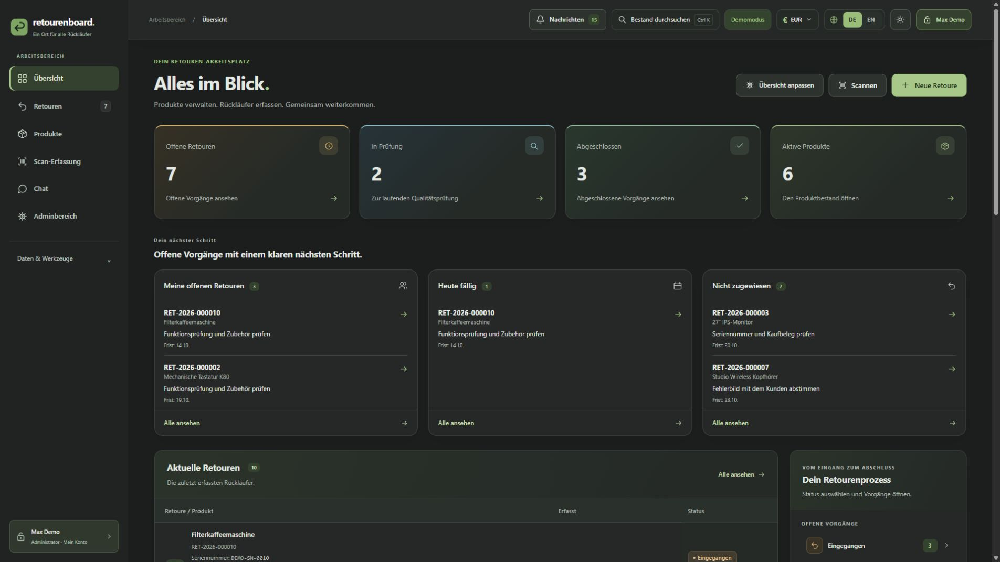

<div align="center">

# retourenboard.

**Ein Ort für alle Rückläufer.**

Produkte verwalten, Retouren erfassen und im Team zusammenarbeiten –
modern, übersichtlich und selbst gehostet.

</div>

<p align="center">
  
</p>

## Überblick

**retourenboard.** ist eine Webanwendung für die strukturierte Verwaltung von **Produkten**, **Retouren**, **Scan-Erfassung** und **Teamkommunikation**.
Die Oberfläche ist auf einen klaren Workflow ausgelegt: vom Eingang eines Rückläufers über Prüfung und Bearbeitung bis zum Abschluss.

### Das bietet retourenboard.

- **Zentrale Übersicht** mit Kennzahlen, offenen Aufgaben und aktuellen Vorgängen
- **Retourenverwaltung** mit Status, Gründen, Zuständigkeiten und Detailansicht
- **Produktbestand** mit Kategorien, Lieferanten, Preisen und Such-/Filterfunktionen
- **Scan-Erfassung** für eine schnelle Aufnahme neuer Geräte und Seriennummern
- **Teamchat** direkt in der Anwendung
- **Stammdaten & Administration** für einheitliche Prozesse
- **CSV-Import / CSV-Export** für Datenaustausch und Massenpflege
- **Selbsthosting** per Docker Compose oder klassischer Linux-Installation

> **Hinweis:** Die folgenden Screenshots sind Demo-Ansichten und können in dieser README direkt verwendet werden.

---

## Screenshots

### Dashboard / Übersicht

<table>
  <tr>
    <td width="80%">
      
    </td>
    <td width="20%" align="center" valign="top">
      
    </td>
  </tr>
</table>

Die Übersicht zeigt offene Rückläufer, laufende Prüfungen, aktive Produkte und die nächsten konkreten Arbeitsschritte auf einen Blick.

### Retourenverwaltung

<p>
  
</p>

Retouren lassen sich durchsuchen, filtern und nach Bearbeitungsstatus organisieren. Wichtige Informationen wie Seriennummer, Retourengrund, Zuständigkeit und nächster Schritt sind direkt sichtbar.

### Retourendetails

<p>
  
</p>

Die Detailansicht bündelt alle Informationen zu einer Retoure – inklusive Gerätedaten, Zuordnung, Prüfung, Bearbeitung und Aktionen wie Bearbeiten, Status ändern oder Etikett drucken.

### Produkte

<p>
  
</p>

Die Produktverwaltung hält den gemeinsamen Bestand an einem Ort zusammen – mit Kategorie, Lieferant, Preis und Status.

### Teamchat

<p>
  
</p>

Direkte Kommunikation im System hilft, Rückfragen und Abstimmungen ohne Medienbruch festzuhalten.

---

## Funktionsbereiche

| Bereich | Beschreibung |
| --- | --- |
| Übersicht | Kennzahlen, Aufgaben und aktuelle Rückläufer |
| Retouren | Erfassung, Suche, Filter, Zuständigkeiten und Status |
| Produktbestand | Gemeinsame Verwaltung aller Produkte |
| Scan-Erfassung | Schnelles Anlegen neuer Rückläufer |
| Chat | Teamkommunikation und Abstimmung |
| Administration | Verwaltung von Konten, Regeln und Grundeinstellungen |
| CSV | Import und Export strukturierter Daten |

---

## Schnellstart mit Docker Compose

Voraussetzung: **Docker** und **Docker Compose** sind installiert.

```bash
docker compose up -d --build
```

Danach ist retourenboard. standardmäßig unter folgender Adresse erreichbar:

```text
http://SERVER-IP:3000
```

### Nützliche Befehle

```bash
# Starten / aktualisieren
docker compose up -d --build

# Status prüfen
docker compose ps

# Logs verfolgen
docker compose logs -f retourenboard

# Stoppen
docker compose down
```

Die mitgelieferte `compose.yaml` ist für einen einfachen Start gedacht. Für produktive Umgebungen empfiehlt sich zusätzlich ein Reverse Proxy mit HTTPS und regelmäßigen Backups.

---

## Erste Schritte

1. Anwendung starten
2. Im Browser öffnen
3. Administratorkonto anlegen
4. Stammdaten und Benutzer einrichten
5. Produkte importieren oder anlegen
6. Retouren erfassen und im Team bearbeiten

---

## Technische Basis

- **Backend:** Node.js
- **Frontend:** Weboberfläche
- **Datenbank:** SQLite
- **Betrieb:** Self-Hosted

---

## Dateien in diesem Paket

- `README.md`
- `compose.yaml`
- `readme_assets/` mit allen eingebundenen Screenshots

Wenn du diese README in ein Repository übernimmst, sollten die Bilder im Ordner `readme_assets/` mit übernommen werden, damit die Vorschau korrekt angezeigt wird.
