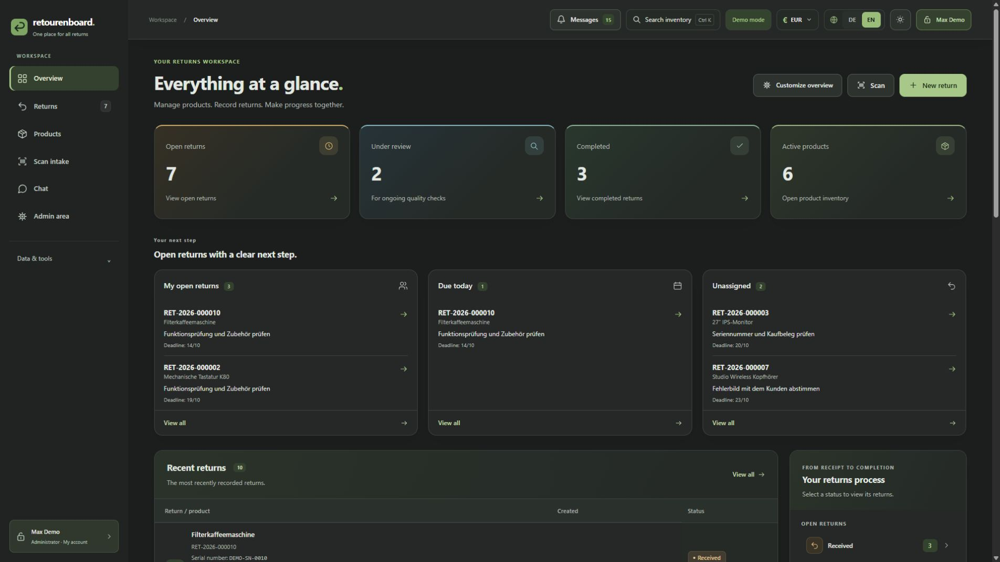
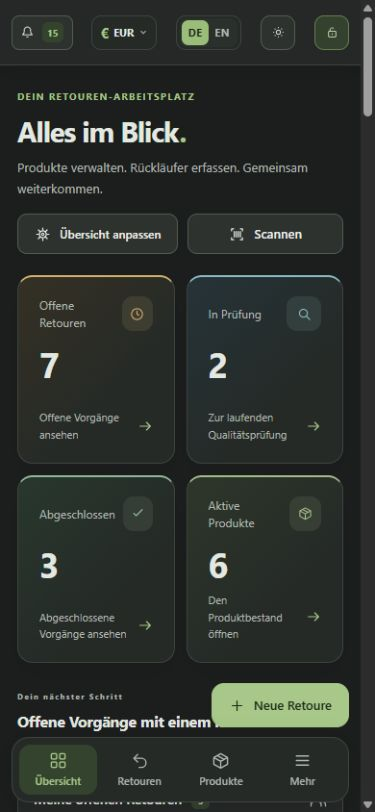
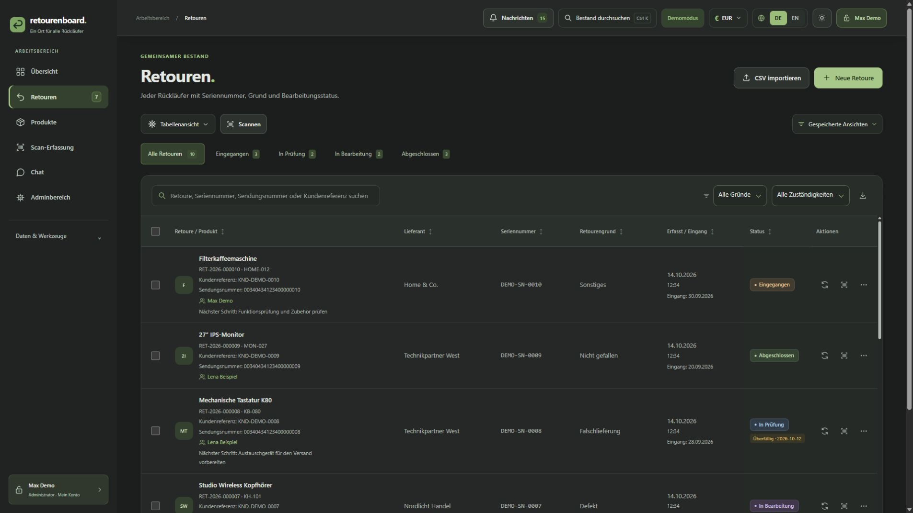
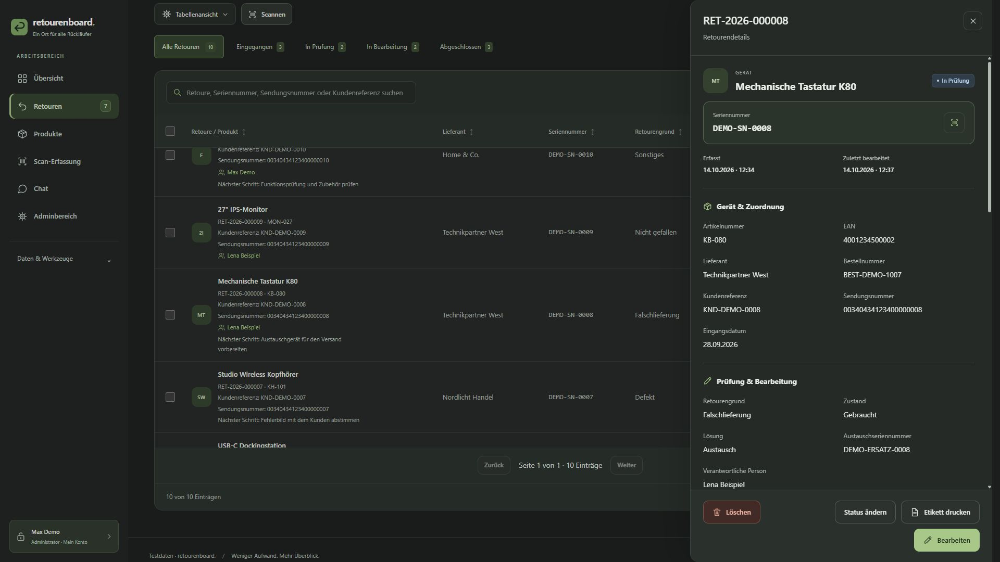
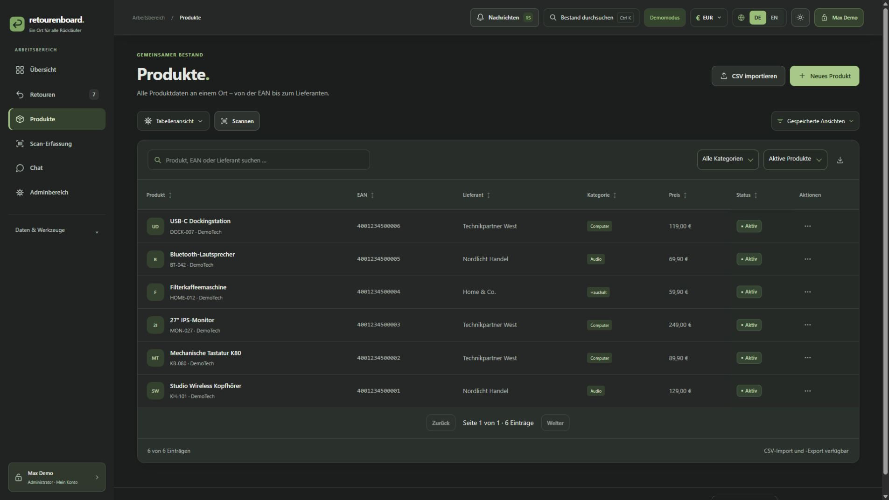
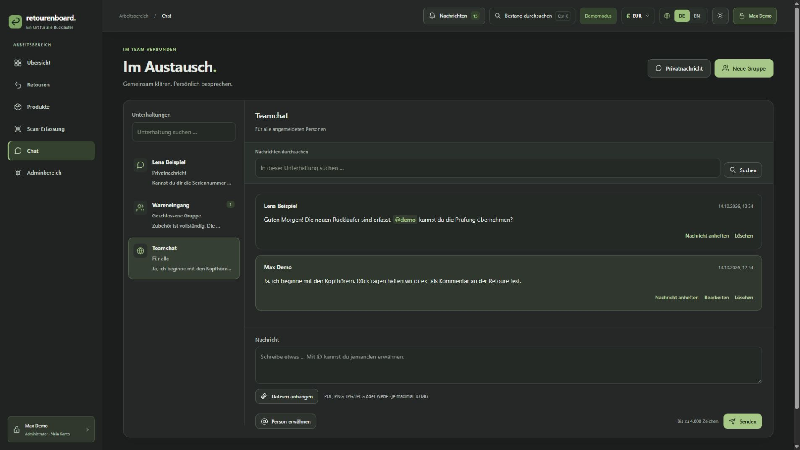

<div align="center">


# retourenboard.

### One place for every return.

**Manage products. Process returns. Move forward together.**

A modern, self-hosted application for returns management, product inventory and team collaboration.

[](https://github.com/KaterBeratung/retourenboard)
[](#docker-compose)
[](#technology)
[](#technology)
[](README.md)

[**Getting started**](#quick-start) · [**Features**](#features) · [**Screenshots**](#screenshots) · [**Deutsch**](README.md) · [**Latest release**](https://github.com/KaterBeratung/retourenboard/releases/latest)

</div>

<p align="center">
  
</p>

<table>
<tr>
<td width="50%" align="center"><strong>📦 Everything in one place</strong><br>Products, returns, workflows and master data together.</td>
<td width="50%" align="center"><strong>🔎 Find the right record</strong><br>Search, filters, barcode scanning and quick actions.</td>
</tr>
<tr>
<td align="center"><strong>👥 Built for teams</strong><br>Assignments, comments, chat and individual permissions.</td>
<td align="center"><strong>🛡️ Your infrastructure</strong><br>Self-hosted SQLite, backups and optional HTTPS proxy.</td>
</tr>
</table>

> **Screenshots:** These are fictional demo records. Names, products and serial numbers are sample data. No fixed application release number is embedded in this README.

## Quick start

For a **Docker Compose** installation, extract the entire release package and run:

```bash
docker compose up -d --build
docker compose ps
```

The default binding is `http://127.0.0.1:3000` **on the Docker host only**. To permit access from your LAN, copy `.env.compose.example` to `.env`, set `RB_BIND_IP=0.0.0.0`, and restart with `docker compose up -d`.

For a **Debian / Ubuntu / Proxmox LXC** installation, download the installer from [the latest GitHub release](https://github.com/KaterBeratung/retourenboard/releases/latest) and run it as root:

```bash
sudo bash retourenboard-install.sh
```

Then visit `http://SERVER-IP:3000` and set up your first administrator account. See [Linux installation](#linux-installation).

---

## Screenshots

### Overview — desktop and mobile

<table>
<tr>
<td width="77%" valign="top"></td>
<td width="23%" align="center" valign="top"></td>
</tr>
</table>

### Returns



<details>
<summary><strong>View the return details panel</strong></summary>



</details>

### Products



### Team chat



<details>
<summary><strong>View the German dashboard</strong></summary>


</details>

> The product, returns, chat and mobile screenshots are shown in German; the application supports both German and English.

---

## Contents

- [Features](#features)
- [Docker Compose](#docker-compose)
- [Linux installation](#linux-installation)
- [Accounts, roles and 2FA](#accounts-roles-and-2fa)
- [Products and returns](#products-and-returns)
- [Scanning and printing labels](#scanning-and-printing-labels)
- [CSV and JSON import/export](#csv-and-json-importexport)
- [Product images and attachments](#product-images-and-attachments)
- [Chat, comments and notifications](#chat-comments-and-notifications)
- [Language, appearance and currency](#language-appearance-and-currency)
- [Reverse proxy and HTTPS](#reverse-proxy-and-https)
- [Backups and recovery](#backups-and-recovery)
- [Updates](#updates)
- [Local development and demo](#local-development-and-demo)
- [Product website](#product-website)
- [Technology and repository layout](#technology)
- [Troubleshooting](#troubleshooting)

## Features

| Area | What you can do |
| --- | --- |
| **Overview** | Track returns, current status counts, personal tasks, due dates, trends and recent records. |
| **Products** | Maintain part numbers, EANs, names, descriptions, EUR prices, suppliers, manufacturers, categories, images and archived records. |
| **Returns** | Record serial numbers, return reasons, conditions, workflow status, resolutions, shipping references, deadlines, notes and assigned team members. |
| **Scan intake** | Add multiple serial numbers using a USB scanner, camera, image or PDF. Create a separate return for every selected device. |
| **Workflow** | Assign owners and next steps, view history and comments, bulk-change statuses and undo recent status changes. |
| **Attachments** | Attach supported images and PDF documents with preview, download and role-specific access control. |
| **Import / export** | CSV profiles, validation previews, duplicate strategies and a JSON inventory transfer format. |
| **Collaboration** | Team chat, private conversations, groups, messages, mentions, pins and comments attached to returns. |
| **Administration** | Master data, return rules, audit history, user accounts, permissions, backups, diagnostics and notifications. |
| **Personalization** | German / English, light / dark theme, reduced motion, column preferences, saved views and EUR / USD display. |
| **Security** | Login, TOTP two-factor authentication, recovery codes, server-side authorization and administrator-controlled settings. |

The application runs as **one Node.js service** with an SQLite database and durable storage. A separate database server is not required. It is intended for a single writer/server instance; do not mount the same live data volume into multiple active instances.

## Docker Compose

### Requirements

- Docker Engine and the Docker Compose plugin (`docker compose`).
- A complete, extracted application release containing `Dockerfile`, `dist/`, `scripts/`, `package.json` and `compose.yaml`.
- An available host port (3000 by default).

The included Dockerfile uses **Node.js 24**, runs as the unprivileged `node` user and starts the prebuilt application. No registry login or npm installation is needed for the packaged Docker runtime.

### Start

```bash
# Optional: create your own deployment settings
cp .env.compose.example .env

# Build from the extracted release and start
docker compose up -d --build

# Inspect container health and logs
docker compose ps
docker compose logs --tail=100 -f retourenboard
```

Open `http://127.0.0.1:3000` from the Docker host. The browser prompts you to create the first administrator on a fresh installation. A health check queries `GET /health` on internal TCP port 3000.

### Persistent application data

The Compose file attaches the named Docker volume `retourenboard-data` at `/data`. The volume contains:

- SQLite database (`retouren.sqlite` plus SQLite journal/WAL files)
- Return attachments (`attachments/`)
- Chat attachments (`chat-attachments/`)
- Generated backups (`backups/`)
- Server-side secrets (`secrets/`), including the MFA encryption key

The volume has a fixed name and is reused when switching to another extracted release folder. **Never use `docker compose down -v` if you want to keep the data.** `docker compose down` alone does not delete the named volume.

### Host binding / LAN access

By default, the host-port binding is restricted to loopback. To allow connections from trusted LAN devices, create `.env`:

```dotenv
RB_BIND_IP=0.0.0.0
RB_PORT=3000
RB_NODE_ENV=development
RB_SECURE_COOKIES=false
```

Apply with `docker compose up -d`; visit `http://SERVER-IP:3000`. You can change the host port to 3001 through `RB_PORT=3001`, but the **internal port must remain 3000**. Check firewall rules before enabling LAN access. Plain HTTP is unencrypted; do not publish it directly to the public Internet.

### HTTPS proxy

For access through a trusted HTTPS reverse proxy, for example:

```dotenv
RB_BIND_IP=127.0.0.1
RB_PORT=3000
RB_NODE_ENV=production
RB_SECURE_COOKIES=true
RB_PUBLIC_ORIGIN=https://returns.example.com
RB_TRUSTED_PROXIES=
```

`RB_PUBLIC_ORIGIN` must match the actual public HTTPS origin (including an external port if one is used; no path). Set `RB_TRUSTED_PROXIES` only to the IPs of reverse proxies you actually control if forwarded client IP headers are required.

A proxy in a different Docker container cannot reach this service through its own `127.0.0.1`. Connect both containers on a trusted Docker network and proxy to `retourenboard:3000`, or intentionally publish the port on an interface reachable by that proxy. A reverse proxy and TLS certificate are **not** automatically provisioned by this Compose file.

### Updating the container

First back up your data. Extract the **new complete release package** to a new folder and use its Dockerfile and built `dist/` files. The local Compose image has a stable, version-independent name. Start it with:

```bash
docker compose up -d --build
```

The existing `retourenboard-data` volume is retained. Do not run two independent instances against it. For a prebuilt registry deployment, the project documentation also describes `ghcr.io/katerberatung/retourenboard:latest`; switching to a registry image requires removing the Compose `build` block and choosing the image tag explicitly. In-app systemd updates do **not** update Docker images.

### Docker backup

You can create a consistent archive in **Admin area → Backups**. For a **complete offline copy, including the secret keys**, stop the container first:

```bash
docker compose stop retourenboard
mkdir -p ./retourenboard-backup
docker compose cp retourenboard:/data/. ./retourenboard-backup/
docker compose start retourenboard
```

Store this directory securely off-host and verify that the container is healthy afterward. The data and secrets are sensitive; do not commit backups to Git. For a full restoration, stop the application and restore a tested, complete volume snapshot rather than mixing old and new live SQLite files.

## Linux installation

### Debian, Ubuntu and Proxmox LXC

For managed Linux installs, use Debian or Ubuntu with systemd on `x86_64` or `arm64`, Internet access, and root/sudo permissions. A Proxmox unprivileged LXC may require **Nesting** if systemd restrictions prevent the service from starting. The installer sets up Node.js, the application and auto-starting systemd services.

1. Open the [latest releases page](https://github.com/KaterBeratung/retourenboard/releases/latest).
2. Download the small installer script (`retourenboard-install.sh` or a release-named equivalent).
3. Copy it to the host and run `sudo bash retourenboard-install.sh`.
4. Open the IP and port reported by the installer, then create the first administrator.

The installer downloads the latest release archive and matching SHA-256 digest, checks the package and installs an official Node.js 24 runtime. A full npm installation on the Linux server is not required when using the built release.

### Dry-run and test mode

```bash
bash retourenboard-install.sh --dry-run
bash retourenboard-install.sh --test --once
bash retourenboard-install.sh --test --lan
bash retourenboard-install.sh --test --lan --port 3002
```

The test runs with a temporary database and does not overwrite existing application data. Its default port is 3001; Ctrl+C ends interactive test mode. You can bind only to localhost with `--local`, bind to all IPv4 interfaces with `--lan`, or prepare a domain using `--domain returns.example.com` during new installations. `--domain` alone does not create DNS, a TLS certificate or a proxy.

### Installing from a complete TAR release

```bash
mkdir retourenboard-package
tar -xzf retourenboard-linux-RELEASE.tar.gz -C retourenboard-package
cd retourenboard-package
bash scripts/install-linux.sh --dry-run
sudo bash scripts/install-linux.sh
```

Replace `retourenboard-linux-RELEASE.tar.gz` with the **actual downloaded filename**. Check the adjacent `.sha256` digest if supplied. The `scripts/install-linux.sh` script requires the complete extracted package.

### Service control and locations

```bash
sudo systemctl status retourenboard --no-pager
sudo journalctl -u retourenboard -f
sudo systemctl restart retourenboard
sudo systemctl status retourenboard-updater --no-pager
```

| Location | Purpose |
| --- | --- |
| `retourenboard.service` | Main application service |
| `retourenboard-updater.service` | Managed, privileged Linux update helper |
| `/opt/retourenverwaltung/current` | Active release files |
| `/opt/retourenverwaltung/releases/` | Locally installed release snapshots |
| `/opt/retourenverwaltung/node/bin/node` | Managed Node.js runtime |
| `/var/lib/retourenverwaltung/` | Database, attachments, backups and secrets |
| `/etc/retourenverwaltung.env` | Protected service configuration |
| `/var/lib/retourenboard-updater/` | Offline update and recovery state |

The historic filesystem prefix and service-user name `retourenverwaltung` are retained for compatibility. Administrators can also view service information and request restarts in the server settings. For a safe temporary shutdown:

```bash
sudo systemctl disable --now retourenboard-updater.service
sudo systemctl disable --now retourenboard.service
```

This leaves files and data intact; the installer does not provide a generic `--uninstall` switch.

## Accounts, roles and 2FA

On the first browser visit, create the administrator. **There is no public signup** afterward; admins add and manage user accounts under **Admin area → User accounts**.

- **Administrator:** Full administrative permissions.
- **Staff:** Working permissions for data, CSV and team functions; can be customized and delegated granular admin tasks.
- **Read-only user:** Read access with selected export, file, audit-history or diagnostics permissions. Write access stays disabled.

The app includes **25 granular permissions**. Product, return, attachment, chat, comment, master-data, CSV-profile, rules and diagnostic permissions are checked on the server, including for direct API requests. Account management, server settings, backups, updates and central notification settings stay administrator-only. Removing an account's CSV edit privileges does not circumvent product or return edit permissions.

Names, passwords, sessions and account preferences can be managed under **My account**. Passwords require 12–256 characters; usernames are 3–64 accepted characters and are case-insensitive at login. Sessions normally last eight hours; administrators can configure 1–24 hours. Password changes, account disablement and server restarts invalidate affected sessions. The last active administrator is protected against accidental removal.

**Two-factor authentication:** The app supports TOTP authenticator applications with **ten one-use recovery codes**. Enrollment requires the current password, a valid TOTP code and confirmation that recovery codes were saved. Sensitive account actions also request a valid factor when 2FA is enabled. An administrator may reset another account's 2FA after authenticating; the user must enroll again. Password resets do not silently remove 2FA.

Offline recovery is available via `scripts/recover-account.mjs` after stopping the managed Linux service. Preserve a secure database backup and use recovery codes or another administrator first.

## Products and returns

### Master data and product inventory

Under **Master data**, create suppliers, manufacturers, categories, return reasons, conditions, statuses and resolutions. Then add products with part numbers and names; EAN, price, descriptions, images and master data are supported. Master-data values can be renamed, archived and reactivated. Existing records retain references to archived values.

Products are searchable by name, part number or EAN. Return forms can select products via keyboard navigation. After creating one return, **Save & another return** retains the chosen product for the next device without carrying over its serial number or customer-specific identifiers.

### Return records and workflow

A new return requires a **serial number**, subject to existing historic records. Optional information includes customer reference, shipping/tracking number, order number, supplier, intake date and notes. The created timestamp is stored separately from the optional intake date. Tracking numbers are stored as text so leading zeroes survive. Return rules can define extra required fields, numbering prefix, time zone and deadline; the initial deadline rule is 14 calendar days in `Europe/Berlin` and can be disabled with 0.

Return records can contain:

- Product association, original serial and optional replacement serial
- Reason, physical condition, processing status and resolution
- Assigned active user and a next action (up to 500 characters)
- Shipping/tracking number and customer reference
- File attachments, comments and time-ordered activity history

Previously used serial numbers trigger a duplicate warning; recording a new return of the same device remains possible after confirmation. Permissions are enforced before saving.

### Finding and organizing work

**Global inventory search** via the header or `Ctrl/Cmd + K` searches names, part numbers, EANs, return IDs, serials, replacement serials, tracking numbers, customer references and suppliers. On mobile, it is available under **More**. Search results open the appropriate record.

Lists support filters, sorting, column visibility, density options and **up to 20 saved views per user per browser**. Filter shortcuts include open, overdue, assigned and unassigned returns. The overview shows personal open work, due-today items, unassigned items, status counts and history/trend summaries.

Authorized users may select **up to 200 returns across list pages** for bulk status updates or selected exports. Status changes can be undone for approximately **12 seconds** if the records have not changed in the meantime. Detail and edit views open in a right-hand side panel while preserving the list behind it. Browser-local drafts of new returns can be recovered for up to 24 hours; they do not store login data or attachments.

## Scanning and printing labels

### Barcode and OCR scanning

The **Scan** actions find products and returns using EANs, serial numbers and return numbers. Inputs support manual entry and USB barcode scanners. Camera, photos and PDF scans are available through the browser where supported.

- The camera starts only after explicit selection and requires **HTTPS or localhost**.
- Barcode recognition works locally in the browser. Camera scanning uses a visible scan region and confirmation before accepting a result.
- Optional text recognition uses bundled **Tesseract.js** to read serial numbers from photos or PDF pages. German and English OCR models are processed locally; no outside OCR service is required.
- PDF scanning supports the first **20 pages** and files up to **20 MiB** for scan processing.
- Detected values can be reviewed in the source image/page before insertion. Always verify OCR results, particularly similar-looking letters and digits.

### Batch scan intake

The separate **Scan intake** workspace begins with a product and shared return fields, then collects individually scanned or pasted serial numbers. Each selected serial becomes its own return. Duplicates inside the intake list are merged; existing returns require deliberate confirmation. A preview confirms which device records will be created. The intake list persists as you navigate within the loaded browser app unless it is explicitly discarded.

### Internal return labels

Saved returns can print **internal equipment labels**, including the return ID, original and optional replacement serial number, a QR code and selected additional fields. Formats include **A4**, **103 × 164 mm**, **62 × 29 mm**, and a general print layout. The QR code only encodes the return number. Choose actual-size/100% printing and disable browser headers/footers for label paper. These are **not shipping carrier labels**.

## CSV and JSON import/export

### CSV imports

Open **Data & tools → Import CSV**. Upload a file or paste CSV text, verify automatic or manual column mappings, inspect the validation preview, then confirm import.

| Type | Required fields |
| --- | --- |
| Products | Part number + product name |
| Returns | Part number + serial number, plus any additionally required fields configured by the return rules |

Supported input includes UTF-8, comma/semicolon/tab delimiters, quoted fields and multiline cell values. Limits: **2 MB CSV**, **10,000 data rows**, **50 columns**. Dates use `YYYY-MM-DD`, monetary amounts are in **EUR**, EAN/serial fields are treated as text. Optional EANs have 8, 12, 13 or 14 digits.

The preview can show suppliers, manufacturers, categories or statuses that would be created if the account has the appropriate permissions. Missing referenced products may be created from return rows when product-creation permission allows it. On validation error, **nothing is imported**. Duplicate handling and whether existing products/returns may be updated depend on the selected options and account permissions. Keep a unique return ID for repeatable return imports.

**CSV profiles** save import type, columns, delimiter and duplicate strategy. CSV exports contain product and return data; a selected-returns export restricts the output to checked items. Formula-like spreadsheet cells are escaped on export to reduce spreadsheet formula execution risk. When opening data in Excel, explicitly import identifiers such as EANs and serials as **text**.

### JSON inventory transfer

The **Export all** function generates `retourenboard-bestand.json`, containing products, linked return data and embedded product images plus referenced master data. It does **not** replace a full administrative backup: chats, accounts, comments, server configuration and return-file attachments are excluded.

The JSON importer previews changes and offers update, skip or error strategies for duplicates. Limits: **32 MB JSON**, **10,000 combined product/return entries**, and **1,000 product images / 20 MB image data in total**, with at most 1 MB per image. Imports are transactionally validated and require the correct creation, edit, import and status permissions.

## Product images and attachments

### Product images

Optional image formats: **PNG, JPG/JPEG and WebP**, up to **1 MB per product**. Images appear in product lists, search and associated returns. Existing images are retained on CSV updates; images are included in JSON inventory transfers and full backups. Access is authenticated and controlled by product permissions.

### Return attachments

Supported file types are **PDF, PNG, JPG/JPEG and WebP** with server-side format validation. PDFs and images can be previewed in the application; PDF previews use bundled Mozilla PDF.js rather than an external viewing service.

Default return limits: **10 files per return**, **10 MiB per file**. Administrators may set file sizes from 1–50 MiB and counts from 1–30 under server settings. File viewing, uploading, downloading and deletion are separately permission-controlled. Return attachments live beside the database in `attachments/` and must be backed up together with it.

## Chat, comments and notifications

The application includes a **team-wide chat**, **private conversations**, and **public or closed groups**. A public group is available to authenticated users with chat permission; private chats and closed groups are accessible only to their participants. Even administrators are not granted unrestricted access to other users' private conversations through the chat UI.

Chat messages support editing, deletion, mentions, search, pins and attached PDF/image files. Supported chat file types mirror return attachments; the default per-file upload limit is 10 MiB. Per conversation, at most 200 files and 250 MiB total are allowed. Attachments are kept under `chat-attachments/` next to the database.

**Return comments** keep discussions with the relevant record. Using `@username` or **Mention person** creates a notification for the selected participant. The personal notification inbox also shows new returns and overdue tasks. Backup-failure notifications are sent to administrators.

SMTP email is optional and disabled by default. Administrators can configure and test it under **Notifications**. TLS/STARTTLS with certificate validation is used; the SMTP password is stored in encrypted form.

**Privacy note:** Private chats are protected by app access controls, but are **not end-to-end encrypted against the server operator**. Operators with access to the database or its backup copies can access their contents.

## Language, appearance and currency

The UI can be switched between **German and English** from the login screen or the header. Default workflow values are translated; user-entered names, products, custom master-data values, comments and CSV values remain unchanged.

The interface supports **dark / light themes** and reduced-motion preferences. Saved column layouts, compact/comfortable table density and custom overview cards are stored as personal preferences. Mobile navigation exposes the main areas and a **More** menu.

Amounts are stored and edited in **EUR**. Users may choose **EUR or USD for display**; an administrator can configure the default. USD display conversion uses a European Central Bank EUR/USD reference rate retrieved via Frankfurter, with a cached last-known rate if live retrieval fails. No product inventory or account data is sent to that currency-rate provider. Imports and exports remain EUR-based.

## Reverse proxy and HTTPS

For public exposure, use a **trusted reverse proxy with HTTPS**, keep the app server on a private network and configure the exact public origin. A managed Linux instance can use a configuration like:

```ini
HOST=0.0.0.0
PORT=3000
DB_PATH=/var/lib/retourenverwaltung/retouren.sqlite
PUBLIC_ORIGIN=https://returns.example.com
SECURE_COOKIES=true
TRUSTED_PROXIES=127.0.0.1,::1
NODE_ENV=production
```

Only put IPs of **your own reverse proxies** in `TRUSTED_PROXIES`. The public origin must match the actual HTTPS hostname, scheme and external port. Reverse proxies should forward `Host`, `X-Forwarded-Proto` and, if configured and trusted, `X-Forwarded-For` correctly.

Example Nginx upstream configuration, **when Nginx and the app run on the same host**:

```nginx
server {
    listen 80;
    server_name returns.example.com;
    client_max_body_size 11m;

    location / {
        proxy_pass http://127.0.0.1:3000;
        proxy_set_header Host $http_host;
        proxy_set_header X-Forwarded-Proto $scheme;
        proxy_set_header X-Forwarded-For $proxy_add_x_forwarded_for;
    }
}
```

Provide the TLS certificate separately, for example through Certbot or your existing proxy platform. Use HTTPS when scanning with device cameras. Allow direct LAN HTTP only when you understand that credentials and other data are transmitted unencrypted. Administrators can configure public origin and other network parameters under **Server settings**; saved network preferences may override the environment-file values.

To reach a localhost-only service securely from another machine without exposing it directly:

```bash
ssh -L 3001:127.0.0.1:3000 USER@SERVER
```

Then open `http://127.0.0.1:3001` locally.

## Backups and recovery

### In-app backups

Under **Admin area → Backups**, administrators can generate and download a TAR backup and restore a validated archive. Automatic backups are initially scheduled **daily at 02:00, Europe/Berlin**, with seven automated archives retained. The schedule, timezone and retention (1–90) are configurable. Manual backups are not automatically removed by rotation.

A backup contains a consistent SQLite snapshot, referenced attachments and an integrity manifest. An archive can be created while the app runs. Archives are admin-only. Limits are **1 GiB per archive/file** and **2 GiB unpacked content**; larger datasets should use a stopped full-directory backup instead.

Restore workflow:

1. Select a backup file from the server or upload a `.tar.gz` in **Backups → Restore**.
2. Check the temporary preview (valid for 15 minutes and bound to your session).
3. Reauthenticate using your password and, if enabled, a 2FA code or recovery code.
4. Confirm replacement of the current inventory, users and application settings.

The app saves the existing state before replacement and invalidates all sessions. Domain, port and TLS settings are retained; SMTP may need to be configured again.

### Protect the secrets separately

**Important:** The encrypted TOTP data depends on `secrets/mfa.key`. This key is deliberately **not** part of the downloadable in-app backup. Preserve it separately alongside your encrypted off-host backup procedure. The SMTP password and its key are also omitted from the downloadable archive. A lost MFA key does not disable 2FA automatically; you will need recovery codes or an authorized offline procedure.

For a managed Linux host, make a complete offline copy with the application stopped (the secret files, SQLite database, journal files and attachments must be saved together):

```bash
sudo systemctl stop retourenboard
sudo sh -c 'umask 077; tar -czf "/root/retourenboard-data-$(date +%F-%H%M%S).tar.gz" -C /var/lib/retourenverwaltung . && systemctl start retourenboard'
```

If `tar` fails, investigate and manually restart after checking the state. Also preserve `/etc/retourenverwaltung.env` securely. Keep backup copies **outside** the host and test recovery.

A validated restore helper is included for downloaded application backups:

```bash
cd /opt/retourenverwaltung/current
sudo /opt/retourenverwaltung/node/bin/node scripts/restore-backup.mjs \
  --archive /secure/path/backup.tar.gz \
  --target /secure/path/restore-test \
  --mfa-key /secure/path/mfa.key
```

The destination must be new or empty. `--mfa-key` is optional, but access to existing factors may require the original key or recovery codes. The helper checks archive paths, checksums, file types and SQLite consistency and does not overwrite an existing database without a separate manual procedure.

## Updates

### Managed Linux installation

You can run the downloaded installer again to install the most recently published release:

```bash
sudo bash retourenboard-install.sh
```

Existing accounts, data, uploads, bind address and settings remain in their dedicated data locations. Before updating, create and download an off-host backup.

Managed systemd installations also support **Admin area → Version & updates** for a manual update after confirmation, current password and potentially TOTP/recovery code. A stable-release check runs automatically at application startup and subsequently every six hours. The updater creates application and offline data backups before switching, restarts the service and attempts rollback on failure. Changes to the update service itself or Node.js may require running the full installer. See [In-app updates](docs/IN-APP-UPDATES.md).

### Docker

Docker installations are updated by **rebuilding or pulling an image**, not by the systemd in-app updater. Extract the new complete release, stop any other instance that writes to the same volume, and start with `docker compose up -d --build`. Keep the persistent `retourenboard-data` volume and verify the health check afterward.

## Local development and demo

### Requirements and basic commands

For source development, use **Node.js 22.16+** (Node.js 24 recommended) and the npm lockfile:

```bash
npm ci
npm run build
cp .env.example .env   # Linux/macOS
npm start
```

On Windows PowerShell use `Copy-Item .env.example .env` instead. The default local instance listens on `http://127.0.0.1:3000` with SQLite under `data/`. Keep a local `.env` when updating a checkout; it can contain deployment-specific settings. Source changes require running `npm run build` again and restarting the app. A missing or incompatible compiled build is rejected.

### Temporary demo with sample records

```bash
npm run preview
# Or specify a port:
npm run preview -- --port 3010
```

The default demo address is **`http://localhost:3002`**, with temporary example data isolated from the primary instance. The example login in the source package is `demo` / `RetourenboardDemo2026!`. Stop with Ctrl+C; the temporary data is removed. **Do not treat the demo login as a production account.**

| Command | Purpose |
| --- | --- |
| `npm start` | Start the compiled app and read `.env` if present |
| `npm run build` | Build server, client and product website |
| `npm test` | Run the test suite |
| `npm run preview` | Start isolated sample-data preview |
| `npm run website:build` | Build the standalone marketing website |
| `npm run website:preview` | Preview that website locally |
| `npm run package` | Create release archives and checksums |

Tests cover API behavior, permissions, CSV, 2FA, backups, updates, UI and installation workflows. They do not replace environment-specific testing of systemd, HTTPS or an actual Docker deployment.

## Product website

The separate `website/` project is a static promotional site. It uses fabricated preview content rather than connecting to the app database. It supports German/English and responsive design, including reduced-motion behavior.

```bash
npm run website:build
npm run website:preview
```

The local preview listens at `http://127.0.0.1:3020` by default. Generated files in `website/dist/` can be published with a static web server. Set the appropriate imprint, privacy details and publication security settings before public hosting. See [Website documentation](website/README.md) in the complete source package.

## Technology

| Component | Stack |
| --- | --- |
| Server | Node.js, TypeScript/JavaScript |
| Frontend | Browser UI with TypeScript, HTML and CSS |
| Data storage | SQLite and on-disk protected files |
| Runtime | Docker Compose or a systemd-managed Linux host |
| Barcode/OCR/PDF | Browser scanning, bundled Tesseract.js and PDF.js |
| Authentication | Session cookies, granular permissions, TOTP and recovery codes |

### Repository layout

```text
retourenboard/
├── backend/src/          # Server sources
├── frontend/             # Client-side sources and UI
├── dist/                 # Compiled application
├── scripts/              # Build, installation, preview and recovery tools
├── deploy/               # Linux service/installer templates
├── docs/                 # Operational documentation
├── website/              # Standalone promotional website
├── previews/             # Demo and design-preview materials
├── tests/                # Automated test suite
├── Dockerfile
├── compose.yaml
├── .env.compose.example
├── README.md             # German
└── README_EN.md          # English
```

The runtime database, `.env`, uploaded files, secrets and backups are not meant to be committed to a public repository or packed into release archives.

## Troubleshooting

| Symptom | What to check |
| --- | --- |
| Web app is unreachable | `docker compose ps`, `docker compose logs --tail=100 retourenboard`, service status, firewall, `RB_BIND_IP` and active port |
| Docker shows `unhealthy` | The app must listen on internal port 3000 and respond to `/health`; inspect startup logs |
| Host port already in use | Change `RB_PORT` for Docker, or choose another test port / application setting for Linux |
| Error behind a reverse proxy | Compare `PUBLIC_ORIGIN` / `RB_PUBLIC_ORIGIN` with the real public URL, `SECURE_COOKIES` and trusted proxy headers |
| Browser camera does not work | Camera scanning needs HTTPS or localhost, a supported browser and device permission |
| Data seems to be missing after a Docker update | Check whether the same named `retourenboard-data` volume is attached. Do not initialize a replacement database before finding the original |
| CSV import fails | Review the dry-run preview, identifiers, date formats, duplicate handling and current user permissions |
| Lost 2FA access | Use a saved recovery code or have another administrator reset MFA; use the offline recovery helper only after backing up |
| App rejects the build | Run `npm ci` and `npm run build`, or use a complete prebuilt release archive |
| Update/restore interrupted | Inspect service and updater logs; consult `docs/IN-APP-UPDATES.md` and preserve recovery state |

### Linux service logs

```bash
sudo systemctl status retourenboard --no-pager
sudo journalctl -u retourenboard -n 100 --no-pager
sudo journalctl -u retourenboard-updater -n 100 --no-pager
```

If a stored network configuration is preventing administrator login behind a proxy, the full German README describes the targeted reset procedure. It resets only saved network settings rather than deleting accounts and returns.

---

## Project and support

- **Releases:** [Latest release](https://github.com/KaterBeratung/retourenboard/releases/latest)
- **Source repository:** [KaterBeratung/retourenboard](https://github.com/KaterBeratung/retourenboard)
- **Support development:** [Ko-fi](https://ko-fi.com/katerberatung)
- **German documentation:** [README.md](README.md)

The material in this README intentionally uses version-independent links. Follow the release page for current package names and build instructions.
