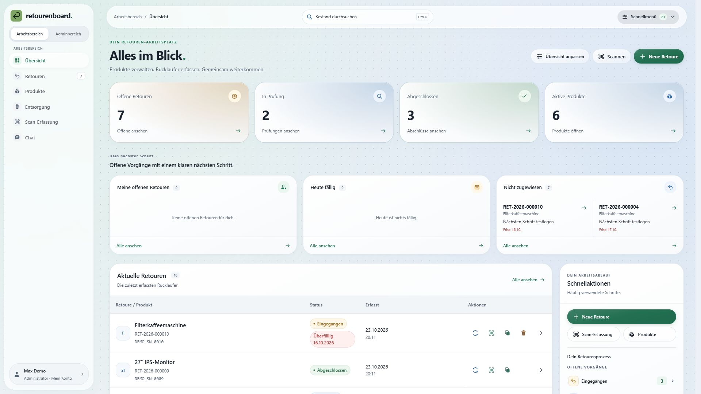
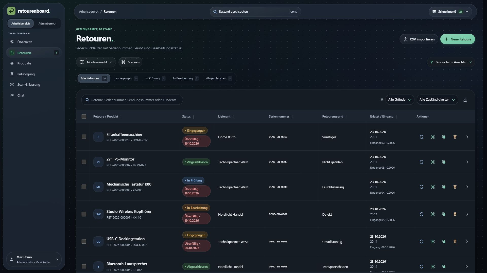
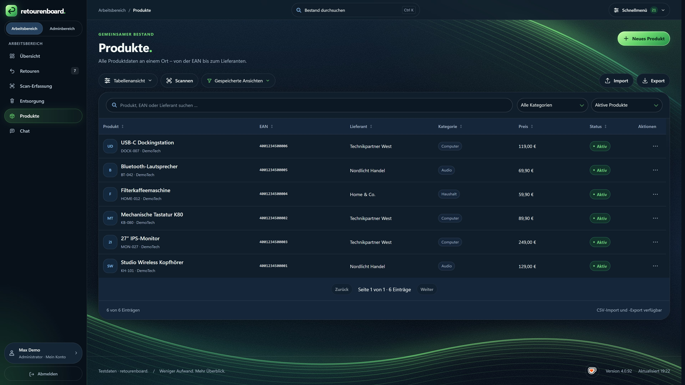
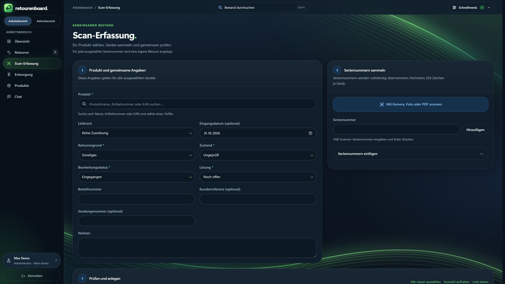
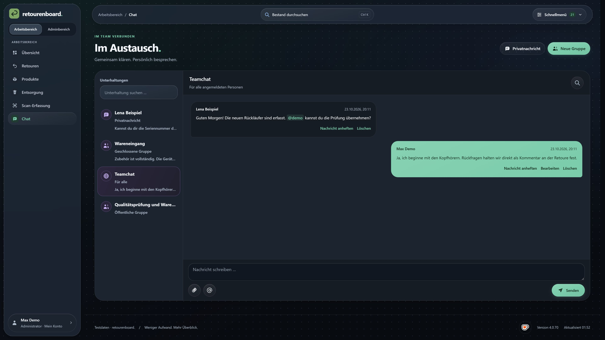
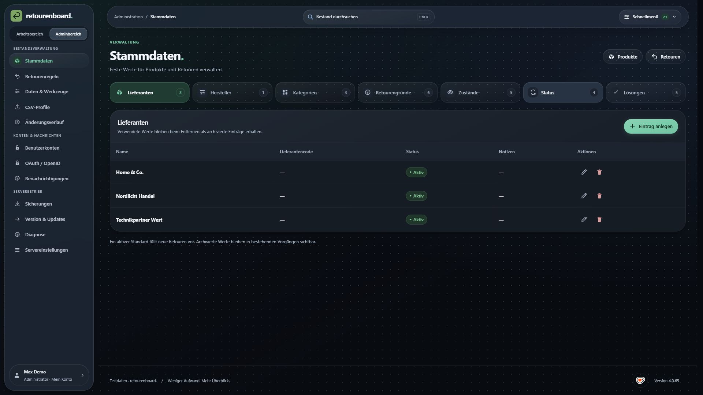
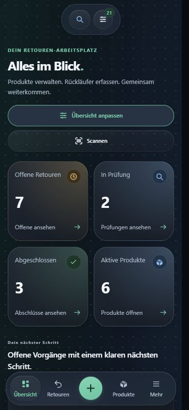
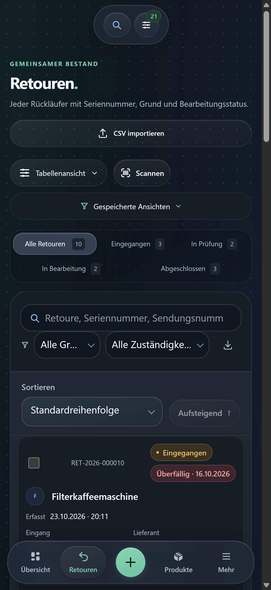
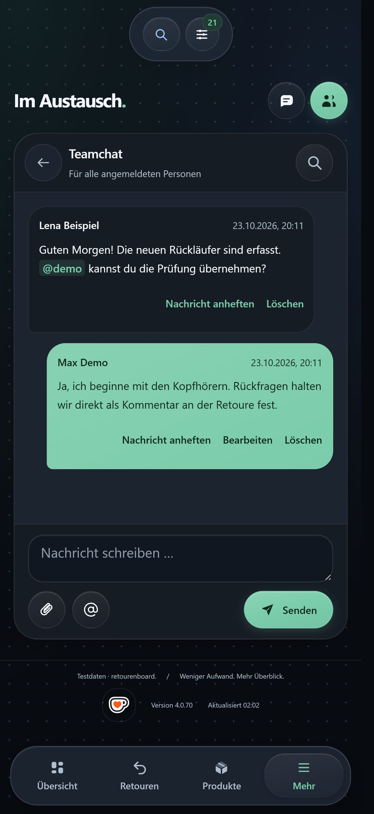

<div align="center">


# retourenboard.

**Ein Ort für alle Rückläufer.**

Produkte verwalten. Retouren bearbeiten. Im Team den Überblick behalten.

[English](README_EN.md) · [Installation](#installation) · [Demo starten](#lokal-ausprobieren) · [Dokumentation](#dokumentation) · [Downloads](https://github.com/KaterBeratung/retourenboard/releases/latest)

**Projektstand 4.0.97** · Selbst gehostet · Node.js 24 · PostgreSQL · Deutsch / Englisch

</div>

<picture>
  <source media="(prefers-color-scheme: dark)" srcset="screenshots/overview-dark-de.jpg">
  
</picture>

retourenboard. ist eine Webanwendung für die gemeinsame Retourenverwaltung. Dein Team arbeitet mit demselben Produkt- und Retourenbestand. Zuständigkeiten, Bearbeitungsstände, Gerätekennungen und Absprachen bleiben am jeweiligen Vorgang nachvollziehbar. Du betreibst die Anwendung auf deinem eigenen Server und vergibst die Zugänge und Rechte selbst.

Alle hier gezeigten Aufnahmen stammen aus der Anwendung und enthalten **synthetische Demodaten**. Desktopbilder sind in **3840 × 2160 Pixeln (4K, 16:9)** aufgenommen; Mobilansichten in **1320 × 2868 Pixeln** mit dem responsiven Format des iPhone 16 Pro Max. Dieselben Motive werden für die Werbeseite verwendet. [Bildübersicht, Aufnahmeverfahren und Prüfsummen](screenshots/README.md).

## Was du damit erledigen kannst

| Bereich | Funktionen |
| --- | --- |
| **Übersicht** | Kennzahlen, echte Verlaufsstatistiken, persönliche Aufgaben, fällige und nicht zugewiesene Retouren; Karten pro Konto anpassen. |
| **Retouren** | Serien- und Austauschseriennummern, Zuständigkeiten, nächste Schritte, Statuswechsel, Übergaben, Verlauf, Kommentare und Dateianhänge. |
| **Produkte** | Produktbilder, Artikelnummern, EAN, Hersteller, Lieferanten, Kategorien und Preise; historische Gerätepreise an Retouren bleiben erhalten. |
| **Scan und Etiketten** | USB- und Kamerascanner, Foto-/PDF-Erkennung, geführte Scan-Erfassung und interne Geräteetiketten mit QR- und Seriennummern-Barcodes. |
| **Geräteworkflow** | Vernichtung, Datenlöschung und Entsorgung mit Freigabe, Einzelgerätekennung, Verlauf und druckbarem Nachweis – auch ohne Retoure. |
| **Zusammenarbeit** | Teamchat, Gruppen, Privatnachrichten, Suche, Anhänge und @Erwähnungen; Zugriff nach Mitgliedschaft und Berechtigung. |
| **Datenaustausch** | CSV-/JSON-Import und -Export, Spaltenzuordnung, Importvorschau und wiederverwendbare CSV-Profile. |
| **Administration** | Einzelrechte, TOTP-2FA, Recovery-Codes, Sitzungsverwaltung, optionales OAuth / OpenID, Sicherungen, Änderungsverlauf und Diagnose. |

Die Oberfläche unterstützt Hell- und Dunkelmodus, Desktop, Tablet und Smartphone sowie anpassbare Animationen. Filter, Sortierung und gespeicherte Tabellenansichten helfen bei größeren Beständen. Ungespeicherte Formulare werden beim Verlassen geschützt; gleichzeitige Änderungen werden auf Konflikte geprüft.

## Ein Blick in die Anwendung

Die folgenden Ansichten zeigen den aktuellen Stand. Die verfügbaren Aktionen richten sich nach den Rechten des angemeldeten Kontos.

<details>
<summary><strong>Retouren – Status, Seriennummern und Schnellaktionen</strong></summary>



</details>

<details>
<summary><strong>Produkte – Katalog und Stammdaten</strong></summary>



</details>

<details>
<summary><strong>Scan-Erfassung – Geräte sammeln und gemeinsam prüfen</strong></summary>



</details>

<details>
<summary><strong>Chat – Absprachen im Team</strong></summary>



</details>

<details>
<summary><strong>Adminbereich – kompakte Kategorien und klare Verwaltung</strong></summary>



</details>

### Auch unterwegs nutzbar

Mobile Ansichten verwenden passende Karten und eine untere Navigation. Auf dem Smartphone lassen sich Einträge und Aktionen ohne seitliches Scrollen durch breite Tabellen bedienen.

<p align="center">
  
  
  
</p>

## Installation

### Debian, Ubuntu oder Proxmox-LXC

Der empfohlene Weg ist der Installer aus einem vollständigen Linux-Release. Benötigt werden ein Debian-/Ubuntu-System mit systemd, Internetzugang und root oder sudo. Unterstützt werden x86_64 und ARM64.

1. Im [gewünschten GitHub-Release](https://github.com/KaterBeratung/retourenboard/releases) das Skript `retourenboard-install-<Version>.sh` herunterladen und auf dem Server als `retourenboard-install.sh` ablegen.
2. Installation starten:

   ```sh
   sudo bash retourenboard-install.sh
   ```

3. Die ausgegebene Adresse öffnen – standardmäßig `http://SERVER-IP:3000` – und den ersten Administrator anlegen.

Der Installer richtet die Node.js-24-Laufzeit, standardmäßig PostgreSQL 18 und den automatisch startenden Anwendungsdienst ein. Externes PostgreSQL 16–18 wird ebenfalls unterstützt. Vor einer öffentlichen Nutzung den Administrator einrichten und HTTPS konfigurieren.

[Ausführliche Installation, LXC und Testmodus](../BETRIEB.md#installation-auf-debian--ubuntu--lxc) · [PostgreSQL und SQLite-Übernahme](../POSTGRESQL.md) · [Reverse Proxy und HTTPS](../BETRIEB.md#domain-reverse-proxy-und-https)

### Docker Compose

Ein vollständiges aktuelles Linuxpaket enthält den fertigen Build und Compose-Dateien. Im entpackten Paketverzeichnis:

```sh
node scripts/setup-docker.mjs
docker compose --env-file deploy/docker/.env -f deploy/docker/compose.yml config --quiet
docker compose --env-file deploy/docker/.env -f deploy/docker/compose.yml up -d --build
```

Das Setup erzeugt eine private Datenbankkonfiguration. Standardmäßig ist die Anwendung unter `http://127.0.0.1:3000` erreichbar; PostgreSQL wird nicht am Host veröffentlicht. Für einen Quellcheckout zuerst mit Node.js ab Version 24 `npm ci` und `npm run build` ausführen.

[Docker-Anleitung: Einrichtung, externe Datenbank, HTTPS und Updates](../DOCKER.md)

## Lokal ausprobieren

Die Demo verwendet eine eigene temporäre Datenbank mit Beispielprodukten, Retouren und Gesprächen. Deine reguläre Datenbank wird dafür nicht verwendet.

Voraussetzungen: **Node.js ab Version 24** und eine [isolierte PostgreSQL-Testumgebung](../POSTGRESQL.md#entwicklung-und-tests), konfiguriert über `RETOURENBOARD_TEST_DATABASE_URL` oder `RETOURENBOARD_TEST_PG_BIN`.

```sh
npm ci
npm run build
npm run preview
```

Anschließend `http://localhost:3002` öffnen. Optional einen anderen Port wählen:

```sh
npm run preview -- --port 3010
```

**Nur für die Demo:** Benutzername `demo`, Passwort `RetourenboardDemo2026!`. Die echte Anwendung richtet keine solchen Standardzugänge ein. Strg+C beendet die Demo und räumt ihre temporären Daten auf.

Für einen regulären lokalen Betrieb `.env.example` nach `.env` kopieren, eine eigene PostgreSQL-Verbindung konfigurieren und `npm start` ausführen. [Vollständige Anleitung](../BETRIEB.md#lokaler-start-und-entwicklung).

## Konten, Daten und Betrieb

- **Zugänge:** Der erste Account wird Administrator. Weitere Konten und ihre Einzelrechte legt die Administration fest. Produkte, Retouren, Chats und Anhänge erfordern eine Anmeldung.
- **OAuth / OpenID:** Optional Microsoft Entra ID oder andere OpenID-Connect-Anbieter anbinden. Global und je Anbieter schaltbar, standardmäßig aus. Nur freigegebene Identitäten, die bestehenden Konten zugeordnet sind, erhalten Zugang. [Einrichtung](../SSO.md).
- **Datenbank:** PostgreSQL 16, 17 oder 18; SQLite dient ausschließlich der kontrollierten Übernahme alter Daten. Vorgesehen ist eine einzelne schreibende Anwendungsinstanz mit dauerhaftem Speicher.
- **Sicherungen:** Manuelle und geplante Sicherungen einschließlich Produktbildern und Anhängen. Archive außerhalb des Servers aufbewahren; benötigte Schlüssel separat sichern. [Sicherung und Wiederherstellung](../BETRIEB.md#sicherungen-und-wiederherstellung).
- **Updates:** Installer erneut ausführen oder auf verwalteten Linuxinstallationen die geprüfte In-App-Aktualisierung verwenden. Docker wird über einen passenden neuen Build aktualisiert. [Updateanleitung](../IN-APP-UPDATES.md).

Der lokale Projektstand und das neueste veröffentlichte Release können voneinander abweichen. Die Anwendung wird aktiv weiterentwickelt; neue Versionen zunächst mit dem eigenen Arbeitsablauf prüfen und vor Updates sichern.

## Entwicklung

| Befehl | Zweck |
| --- | --- |
| `npm ci` | Entwicklungsabhängigkeiten aus der Lockdatei installieren |
| `npm run build` | Server, Frontend und separate Produktwebseite bauen |
| `npm start` | Anwendung mit vorhandener Konfiguration starten |
| `npm run preview` | Temporäre Demo starten |
| `npm test` | Automatisierte Tests mit isoliertem PostgreSQL ausführen |
| `npm run website:preview` | Produktwebseite lokal auf Port 3020 ansehen |
| `npm run package` | Versionierte Linuxpakete, aktuelle Kopien und SHA256-Dateien erstellen |

Die Quellen liegen unter `frontend/` und `backend/`, gemeinsame Assets unter `public/`. `dist/` enthält den Build. Die Produktwebseite unter `website/` ist eine eigenständige statische Seite und hat keinen Zugriff auf Anwendungsdaten. Betreiber- und Rechtstexte müssen vor ihrer Veröffentlichung ausgefüllt werden.

## Dokumentation

- [Betrieb und Nutzung: Installation, Konten, Import, Sicherungen und Fehlerbehebung](../BETRIEB.md)
- [PostgreSQL, Migration und Testumgebung](../POSTGRESQL.md)
- [Retourenworkflow und Abschlussprüfung](../RETURN-WORKFLOW.md)
- [Vernichtung, Datenlöschung und Entsorgung](../DISPOSAL.md)
- [OAuth / OpenID](../SSO.md)
- [In-App-Updates](../IN-APP-UPDATES.md)
- [Docker](../DOCKER.md) · [Frontend](../../frontend/README.md) · [Produktwebseite](../../website/README.md)
- [English README](README_EN.md)

## Mitmachen und unterstützen

Fehler und Verbesserungsvorschläge kannst du als [GitHub-Issue](https://github.com/KaterBeratung/retourenboard/issues) melden. Hilfreich sind Version, betroffene Ansicht, reproduzierbare Schritte und ein Screenshot mit anonymisierten Daten.

Wenn dir retourenboard. im Alltag hilft, kannst du die Weiterentwicklung über [Ko-fi](https://ko-fi.com/katerberatung) unterstützen.
