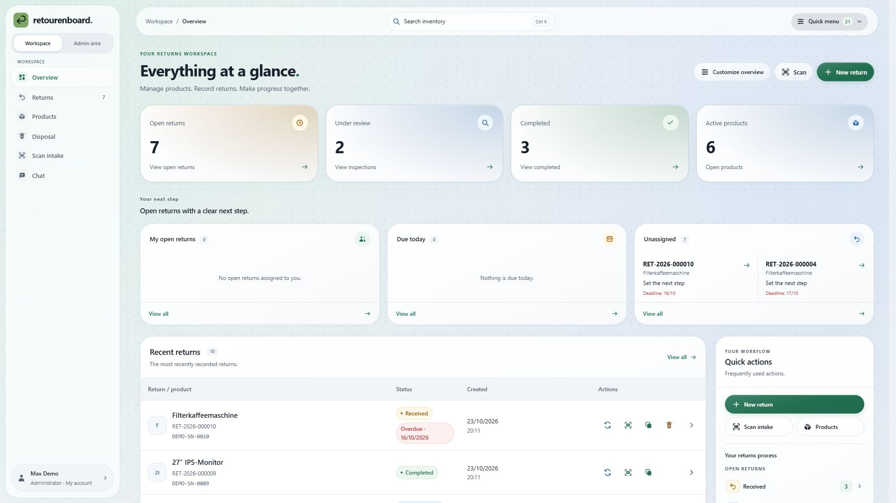
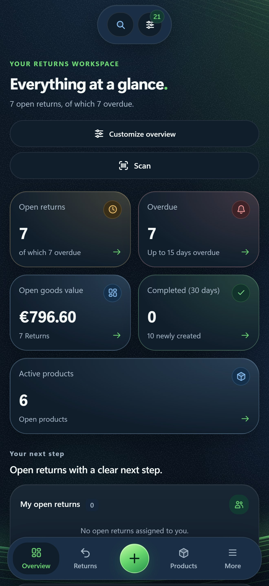

<div align="center">


# retourenboard.

**One place for every return.**

Manage products. Process returns. Keep your team in sync.

[Deutsch](README.md) · [Installation](#installation) · [Try the demo](#try-it-locally) · [Documentation](#documentation) · [Downloads](https://github.com/KaterBeratung/retourenboard/releases/latest)

**Local version 4.0.94** · Self-hosted · Node.js 24 · PostgreSQL · German / English

</div>

<picture>
  <source media="(prefers-color-scheme: dark)" srcset="screenshots/overview-dark-en.jpg">
  
</picture>

retourenboard. is a web application for shared returns management. Your team works with the same product and return records, with assignments, next steps, device identifiers and conversations attached to the relevant work. You run the application on your own server and control accounts and permissions.

These screenshots show the actual application with **synthetic demo data**. Desktop images are **3840 × 2160 pixels (4K, 16:9)**; mobile images are **1320 × 2868 pixels**, using the responsive iPhone 16 Pro Max format. The product website uses the same views. [Screenshots, capture method and checksums](screenshots/README.md).

## Features

| Area | Capabilities |
| --- | --- |
| **Overview** | Metrics, charts based on real records, personal tasks, due and unassigned returns, and customizable dashboard cards. |
| **Returns** | Original and replacement serial numbers, assignments, next steps, status changes, handovers, timeline, comments and attachments. |
| **Products** | Product images, SKU, EAN, manufacturer, supplier, category and prices; return records preserve historical device prices. |
| **Scanning and labels** | USB and camera scanning, image/PDF recognition, guided batch intake and internal labels with return QR and serial-number barcodes. |
| **Device workflow** | Destruction, secure data erasure and disposal with approval, device identifiers, history and printable evidence, including devices without a return. |
| **Team** | Shared chat, groups, direct messages, search, attachments and @mentions, subject to membership and permissions. |
| **Data exchange** | CSV/JSON import and export, column mapping, import preview and reusable CSV profiles. |
| **Administration** | Granular permissions, TOTP MFA, recovery codes, session management, optional OAuth / OpenID, backups, audit history and diagnostics. |

The interface supports German and English, light and dark themes, desktop/tablet/phone layouts and configurable motion. Lists offer filters, sorting and saved views. Unsaved forms are protected when navigating away; concurrent changes are checked for conflicts.

### On your phone

Mobile layouts use compact cards and bottom navigation, making records and their actions accessible without scrolling sideways through wide tables.

<p align="center">
  
</p>

The [German README gallery](README.md#ein-blick-in-die-anwendung) also shows the returns list, products, scan intake, chat, administration and additional mobile screens.

## Installation

### Debian, Ubuntu or Proxmox LXC

Use the installer from a complete Linux release. Requirements: Debian/Ubuntu with systemd, internet access, root or sudo, and x86_64 or ARM64.

1. Download `retourenboard-install-<Version>.sh` from the [desired GitHub release](https://github.com/KaterBeratung/retourenboard/releases), transfer it to your server and name it `retourenboard-install.sh`.
2. Run:

   ```sh
   sudo bash retourenboard-install.sh
   ```

3. Open the address printed by the installer, normally `http://SERVER-IP:3000`, and create the first administrator.

The installer sets up Node.js 24, PostgreSQL 18 by default and an automatically started application service. External PostgreSQL 16–18 is also supported. Set up the administrator and HTTPS before public use.

[Detailed installation and LXC notes (German)](../BETRIEB.md#installation-auf-debian--ubuntu--lxc) · [PostgreSQL and migration](../POSTGRESQL.md)

### Docker Compose

A complete current Linux package contains the compiled build and Compose files. From the extracted package directory:

```sh
node scripts/setup-docker.mjs
docker compose --env-file deploy/docker/.env -f deploy/docker/compose.yml config --quiet
docker compose --env-file deploy/docker/.env -f deploy/docker/compose.yml up -d --build
```

Setup generates a private database configuration. The default application address is `http://127.0.0.1:3000`; PostgreSQL is not published on a host port. For a source checkout, first run `npm ci` and `npm run build` with Node.js 24 or later. [Docker setup, HTTPS and updates](../DOCKER.md).

## Try it locally

Requirements: **Node.js 24 or later** and an [isolated PostgreSQL test environment](../POSTGRESQL.md#entwicklung-und-tests), configured through `RETOURENBOARD_TEST_DATABASE_URL` or `RETOURENBOARD_TEST_PG_BIN`.

```sh
npm ci
npm run build
npm run preview
```

Open `http://localhost:3002`. To choose another port:

```sh
npm run preview -- --port 3010
```

**Demo only:** username `demo`, password `RetourenboardDemo2026!`. The demo uses a separate temporary database with sample records and conversations, not your regular database. Ctrl+C stops it and cleans up temporary data. Production does not create these default accounts.

For a regular local installation, copy `.env.example` to `.env`, configure your own PostgreSQL connection and run `npm start`. [Detailed local setup (German)](../BETRIEB.md#lokaler-start-und-entwicklung).

## Accounts and operations

- **Access:** The first account is an administrator. Administrators create further accounts and assign individual rights. Products, returns, chats and attachments require sign-in.
- **OAuth / OpenID:** Optional Microsoft Entra ID and other OpenID Connect providers, with global and per-provider switches. Disabled by default. Only approved identities linked to existing accounts can sign in. [SSO setup](../SSO.md#english).
- **Database:** PostgreSQL 16, 17 or 18. SQLite is only a source for controlled legacy migration. The application is designed for one writing application instance with persistent storage.
- **Backups:** Manual and scheduled backups include records, product images and attachments. Keep copies outside the server and protect required keys separately. [Backups and recovery (German)](../BETRIEB.md#sicherungen-und-wiederherstellung).
- **Updates:** Rerun the installer or use the in-app updater on managed Linux installations. Docker uses a matching new build. [In-app update guide](../IN-APP-UPDATES.md).

The local project version may differ from the latest published release. Development is ongoing: verify new versions with your workflow and back up before updating.

## Development

| Command | Purpose |
| --- | --- |
| `npm ci` | Install dependencies from the lockfile |
| `npm run build` | Build the server, frontend and separate product website |
| `npm start` | Start the configured application |
| `npm run preview` | Start the temporary demo |
| `npm test` | Run automated tests using isolated PostgreSQL |
| `npm run website:preview` | Preview the product website on port 3020 |
| `npm run package` | Create versioned Linux packages, current copies and SHA256 files |

Sources live in `frontend/` and `backend/`, shared assets in `public/`, and compiled files in `dist/`. The product website in `website/` is a separate static site with no access to application data. Complete operator and legal details before publishing it.

## Documentation

- [Operations and usage handbook (German)](../BETRIEB.md)
- [PostgreSQL, migration and test setup](../POSTGRESQL.md)
- [Return workflow](../RETURN-WORKFLOW.md)
- [Destruction, erasure and disposal](../DISPOSAL.md#english)
- [OAuth / OpenID](../SSO.md#english)
- [In-app updates](../IN-APP-UPDATES.md)
- [Docker](../DOCKER.md) · [Frontend](../../frontend/README.md) · [Product website](../../website/README.md)

## Contributing and support

Report bugs or suggestions through [GitHub issues](https://github.com/KaterBeratung/retourenboard/issues). Include your version, the affected screen, reproduction steps and a screenshot with private information removed.

You can support development on [Ko-fi](https://ko-fi.com/katerberatung).
